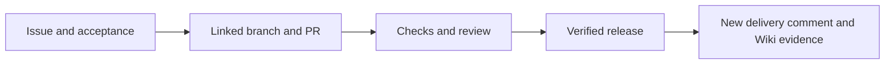

# Full GitHub

[](https://github.com/thinkhome-org/full-github/actions/workflows/check.yml)
[](https://github.com/thinkhome-org/full-github/actions/workflows/security.yml)
[](https://github.com/thinkhome-org/full-github/releases)

A native Codex plugin for discovering, configuring and using GitHub throughout a project's life. Published by ThinkHome.

## Configuration, history and people

Use the [configuration decisions](docs/CONFIGURATION.md) to choose settings inside each feature. Every catalog capability maps to concrete options, provider defaults, project-specific decision rules, sources and verification. The full official REST schema is bundled with nested properties, enums, defaults, required fields, limits and response definitions.

```sh
python3 scripts/operations.py options review
python3 scripts/operations.py option project-event-workflows
python3 scripts/operations.py schema repos/update --section requestBody --pointer /content/application~1json/schema/properties/allow_squash_merge
python3 scripts/operations.py collect issues/list-labels-for-repo --params '{"owner":"thinkhome-org","repo":"full-github","per_page":5}'
python3 scripts/operations.py history --limit 100
```

Page-based collection verifies continuation and totals and keeps received evidence on failure. It detects incomplete search results and avoids assuming the server honored the requested page size.

REST execution records append-only local attempt/result events with host and target metadata. Add --context with an issue/PR/discussion link. Read back the actual state, then record verify-event with its evidence. Payloads and header values are excluded. See the [history guide](skills/full-github/references/history-interaction.md).

People can use [Q&A](https://github.com/thinkhome-org/full-github/discussions/categories/q-a), [Ideas](https://github.com/thinkhome-org/full-github/discussions/categories/ideas), issue forms and PR reviews. The [pinned welcome discussion](https://github.com/thinkhome-org/full-github/discussions/10) explains participation. See [community workflow](docs/COMMUNITY.md), [changelog](CHANGELOG.md) and [recorded decisions](docs/DECISIONS.md).

## Active use and chronological issues

Full GitHub requires agents using the skill to inspect relevant native controls, reconcile useful features and explain unavailable/inapplicable ones. Progress is posted as new issue comments at material checkpoints. The issue body remains the current specification; parallel workers must not overwrite a shared first comment. Issues use chronological comments and quote links; Discussions and PR reviews provide nested replies.

```sh
python3 scripts/audit.py thinkhome-org/full-github --organization --project 5 --issue 14
python3 scripts/check_completion.py coverage-ledger.json
```

The first command inspects issue metadata, comments, timeline, shared fields, Project membership, parent/children, dependencies and artifacts alongside repository probes. Attention prompts need a real decision, rather than artificial dates or relationships. The second checks every catalog capability for a complete, evidence-linked final decision during full setup/audit; incomplete ledgers fail. It validates submitted claims, so inspect linked live evidence separately. See the [issue lifecycle](skills/full-github/references/issue-lifecycle.md) and [completion contract](skills/full-github/references/completion.md).

The skill provides required behavior and executable checks when loaded. Codex controls skill invocation; a plugin cannot globally intercept unrelated agents or guarantee compliance outside its active workflow.

## GitHub writing that carries the work

| Content | Use actively | Verify |
| --- | --- | --- |
| README and Wiki | Navigation, meaningful tables, clear code examples and useful diagrams | Links, real rendering and supported surface |
| Issues and PRs | Acceptance tasklists, linked evidence, new progress comments and targeted review suggestions | Native relationships, actual checks and preserved conversation |
| Releases and Project updates | Reader-facing changes, installation/evidence links and collapsible secondary details | Published destination and verified delivery |



The issue holds scope, comments preserve chronology, and PR/release records supply implementation and delivery evidence.

<details>
<summary>Inspect writing options and rendering requirements</summary>

```sh
python3 scripts/operations.py option github-writing
python3 scripts/operations.py describe markdown/render
```

The [writing runbook](skills/full-github/references/markdown.md) covers GFM plus GitHub-specific alerts, collapsed sections, diagrams, math, citations, media, review suggestions and references. Select each feature for a concrete reader need and verify its destination. The [Wiki writing guide](https://github.com/thinkhome-org/full-github/wiki/Writing) demonstrates the supported documentation workflow.

</details>

## Coverage

The 2026-11-15 inventory contains **261 capability families**, **1,281 published REST operations**, **32 GraphQL queries**, **285 GraphQL mutations** and **1,881 GraphQL types**. The configuration layer contains 469 concrete option decisions across 83 groups. Deprecated and retired operations are identified separately. Eighteen confirmed retired operations are blocked by the REST executor.

- Repository content, Git, Issues, owner issue fields, sub-issues/dependencies, PR stacks, Agent Merge, reviews, rulesets and merge queues.
- Projects fields/options, table/board/roadmap views, view CRUD, workflows, status updates, templates and Insights.
- Discussions, Wiki, search, notifications and collaboration.
- Actions policies, runs, jobs, logs, artifacts, caches, concurrency, runners, environments, approvals, secrets/variables and OIDC.
- Code scanning/quality, Dependabot/dependency graph, secret scanning, security advisories, campaigns and organizational security.
- Releases, assets, attestations, Packages, Pages and deployments.
- Organization/enterprise roles, membership, teams, apps, webhooks, audit, billing, properties, migrations, Codespaces/LFS, Copilot/Spaces, agents/tasks/automations and credentials.

Browse the [capability directory](docs/CAPABILITIES.md) and [complete operation directory](docs/OPERATIONS.md). Each capability has operations, interfaces, official sources, permission gates and verification criteria in the bundled catalog. See [verification](docs/VERIFICATION.md) for executed checks.

## Install

Requires Codex with plugin support, Python 3.10 or newer, Git and authenticated GitHub CLI.

```sh
codex plugin marketplace add thinkhome-org/full-github
codex plugin add full-github@thinkhome
```

For an existing installation, run codex plugin marketplace upgrade thinkhome, then codex plugin add full-github@thinkhome. Open a new Codex chat in your repository and select Full GitHub.

## Use from Codex

- “Audit this repository with Full GitHub and cover every capability.”
- “Set up this repository using the full profile, preserving existing content.”
- “Deliver this issue and maintain its Project, reviews, Wiki and release.”
- “Inspect organization capabilities and report which permissions are missing.”

The agent discovers individual capabilities and uses existing gh, Git, connectors and UI tools. Full setup evaluates the entire catalog and records explicit configuration, applicability and permission evidence. Repository-specific instructions are maintained in GITHUB.md linked from AGENTS.md. Skill selection and automatic invocation depend on the Codex host.

## Discover and execute exact operations

```sh
python3 scripts/operations.py capabilities projects
python3 scripts/operations.py search issue-field
python3 scripts/operations.py describe repos/get
python3 scripts/operations.py call repos/get --params '{"owner":"thinkhome-org","repo":"full-github"}'
python3 scripts/operations.py search ProjectV2 --graphql
python3 scripts/operations.py type UpdateProjectV2ViewInput
python3 scripts/audit.py thinkhome-org/full-github --organization --project 5
```

REST call executes the selected operation using the current gh identity, including writes, and records local execution history by default. Use describe to inspect the method, parameters and official documentation. Supply request bodies through --body-file and preview with --dry-run. GraphQL operations use native gh api graphql with structured variables.

The expanded audit performs repository/organization probes and paginated Project reads. Failed reads remain unknown. It inspects classic branch protection separately from rulesets. Feature-specific object inspection and UI verification complete the coverage ledger.

## Documentation and development

Use the [Wiki](https://github.com/thinkhome-org/full-github/wiki), [execution guide](skills/full-github/references/operations.md), [contribution guide](CONTRIBUTING.md) and [repository workflow](GITHUB.md).

```sh
python3 -m unittest discover -s tests -v
python3 scripts/validate.py
python3 scripts/render_catalog.py --check
```

Tagged releases are built and published by GitHub Actions, with hidden-manifest validation, SHA-256 checksums and GitHub provenance attestations. Verify downloaded ZIPs using gh attestation verify --repo thinkhome-org/full-github PATH.

The source-backed inventory and executable API routes cover a wider surface than the live mutation tests. Plan, credentials, organization policies and host versions determine which operations can execute. The registries identify deprecated and known retired routes. See the verification record for tested operations and unresolved access gates.

## License

The project owner has not selected a license for original plugin content. Third-party OpenAPI data is covered by the MIT notice in [NOTICE.md](NOTICE.md). Contact ThinkHome before redistribution beyond rights granted by GitHub's terms.
