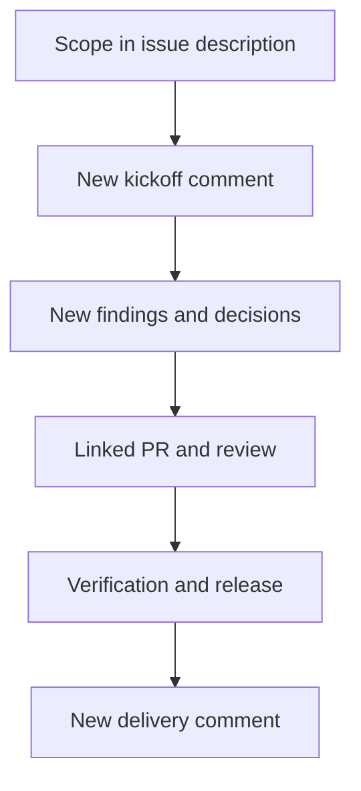

# Writing on GitHub

Use formatting to make the work easier to understand and verify. Read the [full writing runbook](https://github.com/thinkhome-org/full-github/blob/main/skills/full-github/references/markdown.md) and inspect `operations.py option github-writing` for all choices.

> [!TIP]
> Keep the result, decision and next action visible. Put only secondary logs or long examples in collapsed sections.

## Delivery is a conversation

The description stays current while separate comments preserve progress. Native child issues and blockers represent real work relationships; the diagram explains the process.

## Choose the appropriate format

| Reader need | Format | Native proof still needed |
| --- | --- | --- |
| Compare options | Table with descriptive headers | Actual values and sources |
| Track acceptance | Standard checkbox tasklist | Tests and read-back before checking |
| Explain relationships | Mermaid diagram and prose | Actual parent/dependency/PR links |
| Reproduce commands | Language-tagged code block | Executed result in the right environment |
| Find evidence | Explicit source/comment/code permalink | Correct ref, audience and destination |
| Review a line change | Native PR suggestion | Current target, review and applied commit |

Documentation review checklist

Use this checklist for a real writing change; these boxes are examples rather than claims that work is complete.

- [ ] Links and heading anchors lead to intended destinations.
- [ ] Code fences are readable and examples match current commands.
- [ ] Diagrams and any math render in the target browser.
- [ ] Images have meaningful alternative text and correct visibility.
- [ ] Required limitations remain visible outside collapsed detail.
- [ ] Evidence distinguishes preview, publication and actual behavior.

Wiki links use explicit URLs or native Wiki navigation. Footnotes are unsupported here. Repository-file footnotes, conversation reference unfurls and native attachments have their own surface constraints. See the runbook before choosing them.

## Preview and publish

Use the native GFM rendering endpoint with repository context for an HTML preview, then publish through the actual file/comment/Wiki workflow. Preview does not publish and does not verify client-side diagrams or math. Inspect the final destination as its intended audience.

See [[Workflow]], [[History]] and [[Verification]].
